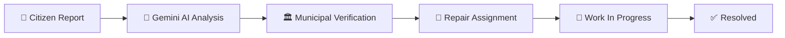
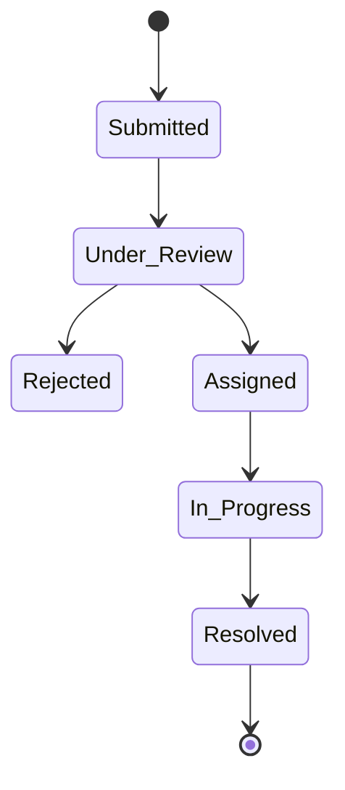
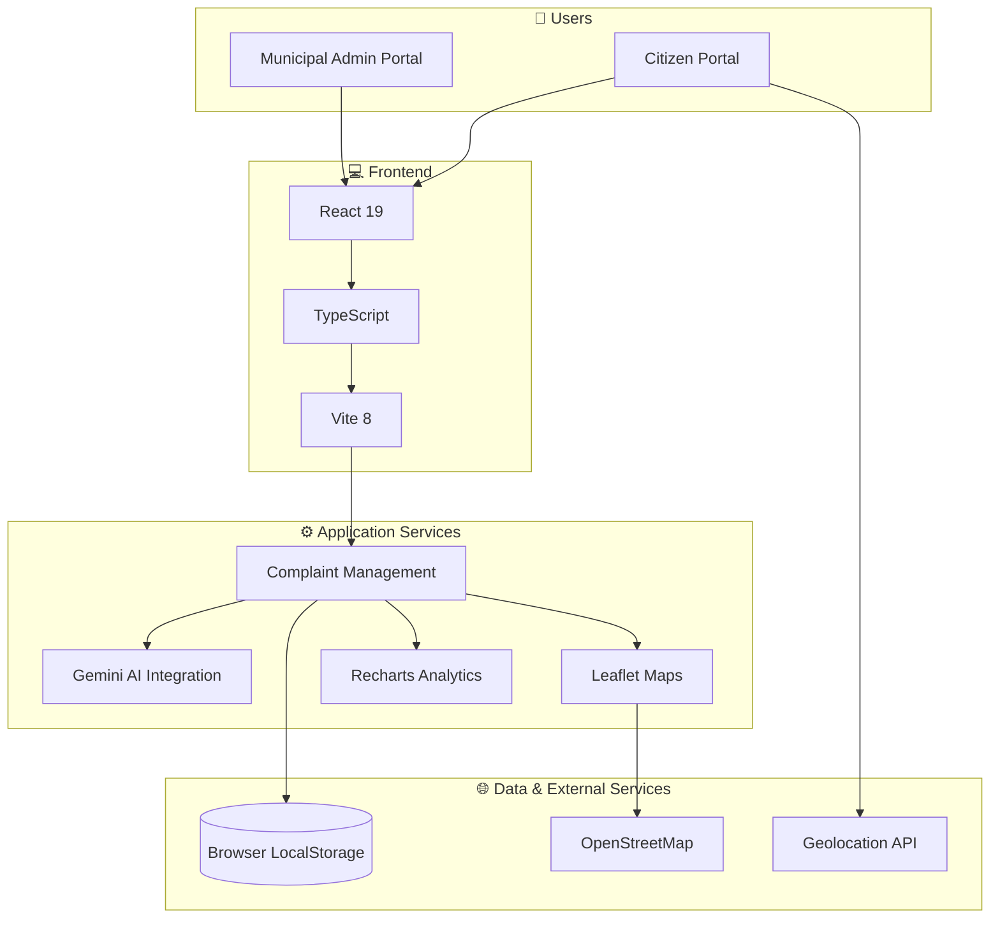

<div align="center">


# RaastaAI

**Smart Road Issue Reporting & Municipal Resolution Platform**

AI-powered civic platform connecting citizens and municipal authorities.

[](https://react.dev)
[](https://www.typescriptlang.org)
[](https://vitejs.dev)
[](https://tailwindcss.com)
[](https://ai.google.dev)

</div>

---

## 🚧 The Problem

Potholes, damaged roads, cracks, and waterlogging create serious public safety risks.

- Citizens lack an efficient way to report and track road issues.
- Municipal authorities struggle with complaint verification and prioritization.
- There is limited visibility into repair progress and accountability.

## 💡 The Solution

**RaastaAI transforms citizen complaints into actionable municipal workflows.**

| 👤 Citizen Portal | 🏛️ Municipal Portal |
|:---|:---|
| Submit road complaints with photos and GPS | Review and verify complaints |
| AI-assisted damage analysis | Assign repair responsibilities |
| Track complaint status | Update repair progress |
| Explore reported issues on maps | Monitor performance and analytics |

---

## ✨ Key Features

- 📸 **Smart Reporting** — Submit road issues with images, descriptions, and GPS coordinates.
- 🤖 **AI Damage Analysis** — Gemini-powered visual assessment of road damage.
- 🗺️ **Interactive Maps** — Explore reported complaints using Leaflet and OpenStreetMap.
- 🏛️ **Admin Dashboard** — Verify, reject, assign, and manage complaints.
- 🔄 **Lifecycle Tracking** — Follow complaints from submission to resolution.
- 🛠️ **Repair Monitoring** — Record repair progress and upload completion evidence.
- 📊 **Analytics Dashboard** — Visualize complaint statistics and resolution trends.

---

## 📸 Application Preview

<div align="center">

| Citizen Portal | Interactive Map |
|:---:|:---:|
|  |  |

| Municipal Dashboard | Analytics Dashboard |
|:---:|:---:|
|  |  |

</div>

---

## ⚙️ How It Works



## 🔄 Complaint Lifecycle



---

## 🏗️ System Architecture



---

## 🧰 Technology Stack

<div align="center">

| Layer | Technologies |
|:---|:---|
| **Frontend** | React 19 · TypeScript · Vite 8 |
| **Styling** | Tailwind CSS v4 |
| **AI Integration** | Google Gemini · `@google/genai` |
| **Mapping** | Leaflet · OpenStreetMap |
| **Visualization** | Recharts |
| **Animations** | Motion |
| **Icons** | Lucide React |
| **Data Storage** | Browser LocalStorage |

</div>

---

## 📁 Project Structure

```text
RaastaAI/
│
├── public/
│
├── src/
│   ├── components/
│   ├── features/
│   │   ├── citizen/
│   │   ├── municipal/
│   │   ├── map/
│   │   └── analytics/
│   │
│   ├── services/
│   ├── types/
│   ├── App.tsx
│   └── main.tsx
│
├── .env.example
├── package.json
└── vite.config.ts
```

---

## 🚀 Getting Started

**1. Clone the repository**

```bash
git clone https://github.com/your-username/raastaai.git
cd raastaai
```

**2. Install dependencies**

```bash
npm install
```

**3. Configure environment variables**

Create a `.env` file:

```env
VITE_GEMINI_API_KEY=your_gemini_api_key
```

**4. Start the development server**

```bash
npm run dev
```

---

## 📝 Current Implementation

> RaastaAI is currently a demonstration application. Complaint data is stored locally using browser LocalStorage. Production backend infrastructure, authentication, and multi-user support are potential future enhancements.

---

<div align="center">

### 🛣️ Safer Roads. Faster Municipal Response.

**RaastaAI**

*Making every road complaint count.*

</div>
